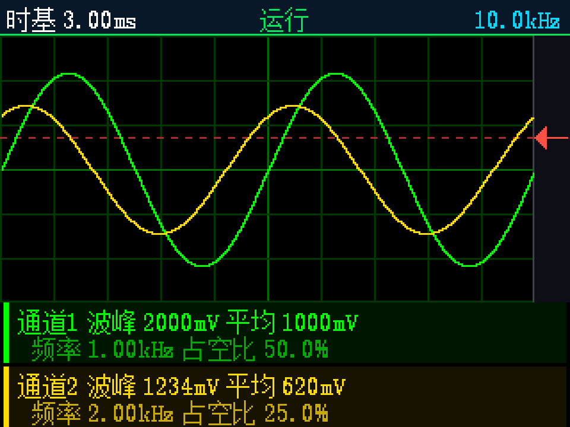

<div align="center">

# DualCore-Oscilloscope · 双核示波器

**1 MSa/s 双通道数字存储示波器** — STM32F407VET6 实时采集核 + ESP32-S3-N16R8 联网核

[](LICENSE)
[](https://github.com/h-xh-git/DualCore-Oscilloscope/releases)
[](#硬件与器件清单)
[](#快速开始)
[](#english)

[中文](#中文) · [English](#english)

</div>

---

## 中文

### 这是什么

一台**自己动手做的双通道数字存储示波器（DSO）**。核心思路是把工作切成两半，各交给一颗最擅长的芯片：

| | **实时核** | **连接核** |
|---|---|---|
| 芯片 | STM32F407VET6（Cortex-M4 @ 168 MHz） | ESP32-S3-N16R8（双核 LX7 @ 240 MHz + Wi-Fi/BLE） |
| 职责 | ADC 采集 → 边沿触发 → 参数测量 → TFT 显示 → 按键/编码器/蜂鸣器 | 网页示波器 → CSV 导出 → 远程控制 → OTA 升级 |
| 特点 | 纯裸机 + 标准外设库，无 RTOS，波形刷新不卡顿 | 只管联网，波形渲染全在浏览器里 |

两颗芯片之间只用一根 **460800 bps 的 UART** 相连，走一套带 CRC-8 校验的轻量帧协议：
STM32 负责「把模拟世界变成数字波形」，ESP32 负责「把波形送上网络」，彼此互不干扰。

- **v0.1** — 首个公开版本，功能完整可用。
- 主要面向：STM32 + ESP32 学习、自制仪器、双核架构参考。

> **注意**：模拟输入端为 **0 – 3.3 V 直采，没有模拟前端（AFE）**，
> 超压会永久损坏芯片。测更高电压请自行加分压/衰减电路，见 [改进方案](#改进方案)。

---

### 界面预览



界面分三层，全屏 **320×240 横屏**：

| 区域 | Y 范围 | 内容 |
|---|---|---|
| 状态栏 | 0 – 19 | 时基、运行/停止、采样率；底边一条运行指示灯（绿=运行 / 橙=停止） |
| 波形画布 | 20 – 169 | 300×150 波形区 + 右侧 20 px 触发位置条；10×6 网格 + 触发电平虚线 |
| 测量卡片 | 170 – 239 | 两张卡片（CH1 / CH2）：波峰、平均、频率、占空比 |

> 上图由 `python tools/preview_ui.py` 在电脑上离线渲染，**不需要接硬件**。
> 该脚本使用真实的字模位图、真实的版面常量和真实的标签字符串，并附带版面几何断言，
> 是修改 UI 时最快的验证手段。

---

### 工作原理

#### 1. 为什么是双核

Wi-Fi 协议栈的响应时间不可预测（扫描、重连、TCP 重传都可能占用 CPU 数十毫秒）。
如果把它和 ADC 采集放在同一颗芯片上，波形就会出现周期性抖动。

因此这里做了**硬实时与软实时的物理隔离**：

- **实时核（STM32）** 只跑一个无 RTOS 的裸机主循环，采集由定时器 + DMA + 中断驱动，
  主循环里没有任何阻塞等待，也不做浮点运算。
- **连接核（ESP32）** 承担所有非确定性的工作：TCP/HTTP、JSON、网页渲染、OTA 刷写。

两者之间只有一条数据流，接口极窄（一根 UART），因此任何一侧改动都不会破坏另一侧的实时性。

#### 2. 采集链路

```
   CH1 ──► PA1 (ADC1_IN1) ─┐
   CH2 ──► PA0 (ADC2_IN0) ─┴─► ADC1 / ADC2 规则同步双重模式
                                  │  两路在同一时刻采样，不存在通道间偏斜
                                  │  TIM2 TRGO 精确定时触发
                                  ▼
                     DMA2 Stream0 Ch0 ◄── ADC->CDR（32 位公共数据寄存器）
                                  │      低 16 位 = CH1，高 16 位 = CH2
                                  │      512 字循环缓冲，半满/全满中断
                                  ▼
                          adc_buf[512]  (uint32_t)
                                  │
                                  ▼
                    环形缓冲 RING_SIZE = 2048（中断内追加，主循环读取）
```

关键点：

- **读 `ADC->CDR` 而不是两个独立数据寄存器。** 双重模式下两个 ADC 的转换结果被硬件打包进同一个
  32 位公共寄存器，一次 DMA 传输同时取回两个通道，天然保证两路对齐，也省掉一半 DMA 带宽。
- **采样率由定时器算出来，不是查表。** TIM2 挂在 84 MHz 时钟上，触发周期为

  ```
  rate = 84 MHz / ((psc + 1) * (arr + 1))
  ```

  代码用 `adc_tim_div()` 按目标频率反解 `psc`/`arr`，因此 100 Hz – 1 MHz 共 13 档
  （`100 / 200 / 500 / 1k / 2k / 5k / 10k / 20k / 50k / 100k / 200k / 500k / 1M`）都是准确的，
  低速档不会因为定时器分频不足而失真。
- **双缓冲 + 环形缓冲两级解耦。** DMA 半满中断把数据搬进 2048 点环形缓冲后立即返回，
  主循环再慢慢做触发搜索和测量，因此采样永远不会因为显示而丢点。

#### 3. 边沿触发

触发搜索窗**按时间换算，而不是固定的采样点数**：

```c
sn = (adc_get_rate() / 1000) * TRIG_SEARCH_MS;   /* TRIG_SEARCH_MS = 10，即 10 ms 的窗 */
if (sn < 200)   sn = 200;                        /* 下限：保证高采样率下也有足够搜索范围 */
if (sn > 1748)  sn = 1748;                       /* 上限：不超过环形缓冲可用深度 */
```

这样无论时基在哪一档，搜索窗覆盖的都是**同样长的一段时间**，低频信号也能稳定抓到边沿。
每帧在窗内寻找符合条件的边沿（上升沿 / 下降沿，触发通道可选 CH1 / CH2），
命中后把触发点固定在距离画面左边缘 `TRIG_PRE = 64` 点的位置，
于是画面上始终能看到触发点前 64 点、后 236 点 —— 这正是示波器"稳定显示"的本质。

#### 4. 参数测量

全部使用**整数运算**，不引入浮点，也不使用 FPU：

- **Vpp / Vmax / Vmin / Vavg**：对 300 点窗口做极值与累加
- **Vrms**：累加平方和后用自实现的整数开方 `scope_isqrt()` 还原
- **频率 / 周期 / 占空比 / 脉宽**：带迟滞的过零检测，最多统计 `SCOPE_CROSS_MAX = 16` 个过零点，
  迟滞带避免噪声在阈值附近产生虚假翻转

#### 5. 显示刷新

- ST7789 面板原生为 240×320 竖屏，驱动里设置 `MADCTL = 0x60 (MV|MX)` 旋转为 **320×240 横屏**，
  像素格式 RGB565 / BGR，走硬件 SPI1。
- **不做整屏帧缓冲**（320×240×2 = 150 KB，超出可用 SRAM 预算），而是直接向面板写命令与像素。
- **脏标记分层**：状态栏字段、波形画布、两张测量卡片、菜单行各自维护脏标记。
  时钟/电压档位这类纯文字变化只重绘文字，绝不重铺波形画布；
  画布只在真正需要时（比如触发电平改变导致网格重画）才重建。

#### 6. 双核桥接

STM32 与 ESP32 之间是一套极简的自定义帧协议，跑在 460800 8N1 上：

```
┌──────┬──────┬──────┬────────┬────────┬──────────────┬───────┐
│ 0xAA │ 0x55 │ type │ len_lo │ len_hi │   payload    │ crc8  │
│  1B  │  1B  │  1B  │   1B   │   1B   │ 0 … 2048 B   │  1B   │
└──────┴──────┴──────┴────────┴────────┴──────────────┴───────┘
  帧头 ────┘      └──────────── CRC-8 覆盖范围 ─────────────┘
```

- 帧头固定 `0xAA 0x55`，`len` 小端，最大负载 `PROTO_MAX_PAYLOAD = 2048`
- CRC-8 多项式 `0x07`（`x⁸ + x² + x + 1`），覆盖 `type + len + payload`
- **STM32 侧发送环满时丢帧而不阻塞**（`proto_drops()` 计数），实时性优先于完整性：
  一帧波形晚到毫无意义，但主循环卡住会直接表现为波形停顿

ESP32 收到后解析、缓存，网页轮询取用；网页上的按钮则反向下发命令给 STM32。
**网页只做显示和转发，所有波形数据都由 STM32 产生** —— 这是桥接架构而不是双主人架构。

---

### 已实现的功能

**实时核（STM32F407）**

- 双通道同步采样，12 bit，13 档采样率：100 Hz – 1 MSa/s
- 硬件定时触发（TIM2 TRGO）+ DMA 循环双缓冲，采样率精确可算
- 环形缓冲 2048 点，触发前/后 64 / 236 点
- **自适应触发搜索窗**（按 10 ms 时间换算，而非固定点数）
- 上升沿 / 下降沿触发，触发通道 CH1 / CH2 可选
- 触发模式：自动 / 常态 / 单次
- 全整数测量：Vpp、Vmax、Vmin、Vavg、Vrms、频率、周期、占空比、脉宽
- 4 档垂直缩放（V/div）、通道独立显示/隐藏
- TFT 320×240 横屏 UI + SSD1306 OLED 状态副屏
- 4 按键 + EC11 旋转编码器 + 10 项菜单 + 蜂鸣器提示音
- 脏标记分层刷新，波形刷新不卡顿
- 无 RTOS 裸机，主循环零阻塞

**连接核（ESP32-S3）**

- 内置网页示波器（单页 HTML 存在 Flash 里，不依赖 CDN，断网可用）
- 网页实时波形（10 Hz）、测量卡片（2 Hz）、控制条（运行/停止、时基、触发模式/边沿/通道、电平滑块）
- 鼠标或手指直接在波形区拖动即可设置触发电平
- **CSV 导出**（300 行原始数据），可直接用 Excel / Python 分析
- 网页配网：SSID/密码写入 NVS，掉电不丢；**密码永不回传**（只回 `has_pass` 布尔量）
- 未配网时自动开 `Oscilloscope-Setup` 热点（`192.168.4.1`）兜底
- mDNS：浏览器直接访问 `http://oscilloscope.local`
- ArduinoOTA 无线升级
- 页面切到后台自动停止轮询，回到前台自动恢复

**HTTP 接口**

| 路由 | 方法 | 作用 |
|---|---|---|
| `/` | GET | 网页示波器主页面 |
| `/stat` | GET | 运行状态（采样率、触发模式、连接状态等） |
| `/meas` | GET | 当前测量值（JSON） |
| `/wave` | GET | 波形数据（约 1200 B 紧凑格式） |
| `/csv` | GET | 波形 CSV 下载 |
| `/cmd` | GET/POST | 下发命令（改采样率、触发电平、运行/停止…） |
| `/wifi` | GET/POST | 配网页面 / 提交凭据 |

---

### 硬件与器件清单

#### 器件清单（BOM）

| 部件 | 型号 / 规格 | 作用 |
|---|---|---|
| 实时核主控 | **STM32F407VET6** 系统板（512 KB Flash / 128 KB SRAM / 64 KB CCM，3×12 bit ADC） | 采集、触发、测量、显示、人机交互 |
| 连接核 | **ESP32-S3-N16R8**（16 MB Flash + 8 MB OPI PSRAM，双核 240 MHz，Wi-Fi/BLE） | 网页示波器、CSV 导出、远程控制、OTA |
| 主显示 | **2.4″ ST7789** TFT，240×320，SPI，RGB565 | 波形与菜单（旋转为 320×240 横屏） |
| 副显示 | **0.96″ SSD1306** OLED，128×64，I2C（兼容 SH1106） | 运行状态、时基、触发状态 |
| 输入 | 4 × 轻触按键 + **EC11** 旋转编码器（带按压） | 菜单导航与参数调节 |
| 提示 | 有源蜂鸣器 | 按键与操作提示音 |
| 供电 | 12 V 锂电池 → DC-DC 5 V → LDO 3.3 V | 整机供电 |
| 调试 | USB-TTL 模块（接 USART1） | STM32 日志；ESP32 直接用板载 CH340 |

#### 实时核引脚分配

| 功能 | 外设 / 接口 | 引脚 | 备注 |
|---|---|---|---|
| CH1 模拟输入 | ADC1_IN1（主） | **PA1** | 采样值在 `ADC->CDR[15:0]` |
| CH2 模拟输入 | ADC2_IN0（从） | **PA0** | 采样值在 `ADC->CDR[31:16]` |
| TFT ST7789 | SPI1 | SCK=PA5, MOSI=PA7, CS=PA4, DC=PB0, RST=PB1, BLK=PB10 | `MADCTL=0x60` 旋转为横屏 |
| OLED SSD1306 | I2C1 | SCL=PB6, SDA=PB7 | |
| 按键 KEY1–KEY4 | GPIO 输入 | PC0 / PC1 / PC2 / PC3 | 内部上拉，按下为低 |
| 旋转编码器 | TIM8 编码器模式 | A=PC6 (TIM8_CH1), B=PC7 (TIM8_CH2), SW=PC8 | 调时基 / 触发点 |
| 蜂鸣器 | GPIO | PB8 | |
| 调试串口 | USART1 | TX=PA9, RX=PA10 | 115200 8N1 |
| → ESP32 | USART2 | TX=PA2, RX=PA3 (AF7) | 460800 8N1 |

#### 双核接线

```
STM32 PA2 (USART2 TX)  ────→  ESP32 GPIO17 (UART1 RX)
STM32 PA3 (USART2 RX)  ←────  ESP32 GPIO18 (UART1 TX)
STM32 GND              ────     ESP32 GND            （必须共地）
```

> [!WARNING]
> **模拟输入不得超过 3.3 V。** STM32 的 ADC 输入范围是 0 – 3.3 V，直采更高电压会永久损坏芯片。
> 本项目**没有输入过压保护电路**，测更高电压前请自行加装分压电阻或运放衰减前端。

ESP32-S3 具体引脚与板载资源见 [`esp32/引脚定义图.png`](esp32/引脚定义图.png)。

---

### 快速开始

#### 0. 依赖

| 依赖 | 版本 / 说明 |
|---|---|
| Keil MDK-ARM | V5，需安装 `STM32F4xx_DFP` 器件包（编译实时核） |
| PlatformIO | Core 6.x（编译连接核），可装在 VS Code 里，也可只用命令行 |
| Python | 3.8+，仅 `tools/` 下脚本需要，**无第三方库依赖** |

`STM32F407_ProjectTemplate/libraries/` 下的 ST 标准外设库与 CMSIS **已随仓库提供**，无需另外下载。

#### 1. 编译烧录实时核（STM32）

1. Keil MDK5 打开 `STM32F407_ProjectTemplate/project/MDK(V5)/Project.uvprojx`
2. 确认器件为 `STM32F407VETx`
3. `F7` 编译，`F8` 用 ST-Link / J-Link 下载

#### 2. 编译烧录连接核（ESP32）

```bash
cd esp32
pio run                        # 编译
pio run -t upload              # 烧录
pio device monitor -b 115200   # 查看启动日志
```

如果报 `Failed to connect`：**按住 BOOT → 点一下 RST → 松开 BOOT → 立刻 Upload**。

> **USB 串口说明**：本工程不覆盖板级的 `ARDUINO_USB_MODE` 宏，保持默认值 `1`，
> 这样 `Serial` 走 UART0（GPIO43/44）→ 板载 CH340，
> **烧录和看日志共用同一个 USB-C 口**。若你的板子使用原生 USB 口，请自行调整 `platformio.ini`。

#### 3. 首次上电：配网

固件里**不包含任何 Wi-Fi 凭据**，所以第一次开机会直接自建配置热点：

```
[WIFI] no credentials stored
[WIFI] no router — starting setup AP
[AP]   SSID: Oscilloscope-Setup   pass: 12345678
[AP]   open http://192.168.4.1/ to configure
```

1. 手机 / 电脑连接热点 **`Oscilloscope-Setup`**，密码 **`12345678`**
2. 浏览器打开 **http://192.168.4.1/**，填入你的路由器 SSID 和密码，保存
3. 断电重启（或点页面上的「重启生效」），设备连上路由器后会打印：

```
[WIFI] connected, IP: 192.168.1.42 (RSSI -55 dBm)
[WEB]  serving on 192.168.1.42
[OTA]  ready
```

4. 浏览器访问 `http://oscilloscope.local` 或上面显示的 IP，即可看到网页示波器

> 也可以把 SSID / 密码填进 `esp32/lib/osc_wifi/osc_wifi.cpp` 顶部的
> `WIFI_SSID_DEFAULT` / `WIFI_PASS_DEFAULT` 让固件开箱即连。
> 请注意这会把凭据**以明文写入固件**，不适合用于需要公开分发的成品。

详细的烧录、操作、调试与故障排查见 **[📖 使用指南](docs/使用指南.md)**。

---

### 目录结构

```
DualCore-Oscilloscope/
├── README.md                       ← 你正在看的这份
├── LICENSE                         ← GPL-3.0
├── NOTICE.md                       ← 第三方组件与字模来源说明（重要，请阅读）
├── CHANGELOG.md
├── .gitignore
├── ui_preview.png                  ← 界面预览图（tools/preview_ui.py 生成）
├── font_chinese_14.h               ← 4bpp 中文字模源文件（生成 ui_font_cn14.h 的输入）
│
├── docs/
│   └── 使用指南.md                  ← 烧录、操作、调试、故障排查
│
├── esp32/                          ← 连接核：ESP32-S3 + PlatformIO
│   ├── platformio.ini
│   ├── 引脚定义图.png
│   ├── src/main.cpp                ← 主流程
│   └── lib/
│       ├── osc_link/               ← 与 STM32 的 UART 链路管理
│       ├── osc_proto/              ← 帧协议编解码 + CRC-8
│       ├── osc_web/                ← WebServer + 内嵌网页（HTML/CSS/JS）
│       └── osc_wifi/               ← STA 连接 / AP 配网 / NVS 存取
│
├── STM32F407_ProjectTemplate/      ← 实时核：STM32F407 + Keil MDK5
│   ├── app/main.c                  ← 主循环 / 状态机
│   ├── board/                      ← 板级初始化、延时
│   ├── module/                     ← stm32f4xx_conf.h、中断向量
│   ├── bsp/
│   │   ├── adc/                    ← 双 ADC 同步 + DMA 采集引擎
│   │   ├── scope/                  ← 触发查找 + 纯整数测量
│   │   ├── proto/                  ← 与 ESP32 的帧协议（STM32 侧）
│   │   ├── uart/  uart2/           ← USART1 调试 / USART2 接 ESP32
│   │   ├── lcd/  oled/             ← ST7789 (SPI) / SSD1306 (I2C)
│   │   ├── key/  encoder/  buzzer/ ← 人机交互
│   │   └── ui/                     ← UI 绘制 + 中文字模 ui_font_cn14.h
│   ├── project/MDK(V5)/            ← Keil 工程（Project.uvprojx）
│   ├── libraries/                  ← ST 标准外设库 + CMSIS（未作修改，请勿改动）
│   └── clean.bat                   ← 清理 Keil 构建产物
│
└── tools/                          ← 电脑端辅助脚本（纯 Python 标准库）
    ├── gen_ui_font.py              ← 生成 STM32 用的 1bpp 中文点阵字模
    ├── gen_ui_text.py              ← 生成 UI 文字标签表
    ├── preview_ui.py               ← 离线渲染界面 + 版面几何断言
    └── show_font.py                ← 在终端里查看字模点阵
```

---

### 技术规格

| 项目 | 参数 |
|---|---|
| 通道数 | 2（ADC1 + ADC2 规则同步双重模式） |
| 采样率 | 13 档，100 Hz – 1 MSa/s |
| ADC 分辨率 | 12 bit（0 – 4095） |
| 输入量程 | 0 – 3300 mV 直采（无 AFE） |
| 采样缓冲 | 环形 2048 点（`RING_SIZE`） |
| 显示缓冲 | 300 点/帧（`WAVE_N`） |
| 触发前/后 | 64 / 236 点（`TRIG_PRE` / `TRIG_POST`） |
| 触发模式 | 自动 / 常态 / 单次 |
| 触发类型 | 边沿（上升 / 下降），通道 CH1 / CH2 可选 |
| 触发搜索窗 | 按时间自适应，20 – 1748 点（默认 10 ms） |
| 测量项 | Vpp / Vmax / Vmin / Vavg / Vrms / 频率 / 周期 / 占空比 / 脉宽 |
| 垂直档位 | 4 档 |
| 显示 | TFT 320×240 横屏（~25 fps）+ OLED 128×64（~3 Hz） |
| 系统时钟 | 168 MHz（PLL 8 → 336 → 168） |
| 核心间链路 | UART 460800 8N1，CRC-8 帧协议，最大负载 2048 B |
| 无线 | Wi-Fi STA（连接路由器）；未配网时自动开 AP 兜底 |

---

### 开发辅助工具

`tools/` 下的脚本**只依赖 Python 标准库**，不需要装任何第三方包，也不需要连接硬件：

```bash
# 离线渲染界面布局，输出 ui_preview.png，并断言版面几何
python tools/preview_ui.py ui_preview.png
# → == geometry == ... 一排 ok
#   == result: OK ==

# 重新生成 STM32 用的中文点阵字模（输入 font_chinese_14.h，输出 bsp/ui/ui_font_cn14.h）
python tools/gen_ui_font.py

# 重新生成 UI 文字标签表（输出 bsp/ui/ui_text.h）
# 非 ASCII 字符统一转成八进制转义的 UTF-8 字面量，保证 C 源文件是纯 ASCII，
# 这样 Keil/ARMCC 不需要 UTF-8 locale 也能正确编译。
python tools/gen_ui_text.py

# 在终端里用 ASCII art 查看某个字的点阵
python tools/show_font.py 时基通道1
```

> `preview_ui.py` 读取的是**真实**的字模位图（`bsp/ui/ui_font_cn14.h`）、**真实**的版面常量
> （`bsp/ui/bsp_ui.h`）和**真实**的标签字符串（`bsp/ui/ui_text.h`），
> 因此它渲染出来的几何与板子上看到的一致。
> `== geometry ==` 下任何一行 `FAIL` 都说明版面已经坏了。

修改 UI 之后建议先跑一次 `preview_ui.py`，比烧录到板子上看屏幕快得多。

---

### 改进方案

#### v0.1 的已知限制

| 限制 | 说明 |
|---|---|
| 无模拟前端 | 只有 0 – 3.3 V 直采，没有衰减、AC/DC 耦合、过压保护和探头补偿 |
| 记录深度固定 | 环形缓冲固定 2048 点，采样率越高，屏幕上能覆盖的时间越短 |
| 触发类型单一 | 只有边沿触发，没有脉宽、斜率、视频触发 |
| 测量为整数运算 | 低采样率下频率分辨率有限，没有 FFT / 频谱功能 |
| 波形不落盘 | 只能通过网页导出 CSV，没有 SD 卡存储和波形回放 |
| 字体授权受限 | 中文字模字形源自宋体（SimSun），存在分发授权灰区，详见 [NOTICE.md](NOTICE.md) 第 5 节 |

#### 规划中的方向

**硬件**

- [ ] **模拟前端（AFE）**：输入衰减与放大、AC/DC 耦合切换、1 MΩ 输入阻抗、TVS + 钳位过压保护
- [ ] 探头补偿与带宽标定，把当前的"直采板"变成可测真实信号的仪器
- [ ] 电池电量检测（ADC 分压）与低电量提示

**采集与触发**

- [ ] 可变记录深度 / 抽取（decimation），高采样率下也能看长时间窗口
- [ ] 增加脉宽触发、斜率触发、窗口触发
- [ ] 单次触发的自动保存与回看

**测量与分析**

- [ ] FFT / 频谱视图（可利用 Cortex-M4 的 DSP 指令与 CMSIS-DSP）
- [ ] 上升时间、峰峰值抖动、占空比抖动的统计（max/min/σ）
- [ ] 光标测量（手动定位两个时间/电压点）

**存储与连接**

- [ ] SD 卡波形存储与回放
- [ ] 网页端波形缩放、平移与历史回看
- [ ] WebSocket 替代轮询，提升网页刷新率
- [ ] 串口协议解码（UART / I²C / SPI）辅助调试

**工程**

- [ ] **替换为开源自适应字体**（如思源黑体 / 文泉驿），彻底消除字模授权灰区
- [ ] 增加 STM32 侧的单元测试（触发与测量函数可在 PC 上编译验证）
- [ ] GitHub Actions：自动编译 ESP32 固件、自动跑 `preview_ui.py` 版面断言

欢迎提 Issue 或 PR 一起推进。

---

### 第三方组件与许可

本仓库包含或派生自若干第三方组件，**分发前请务必阅读 [NOTICE.md](NOTICE.md)**，其中逐项列出了：

- ST 标准外设库与 CMSIS（STMicroelectronics / ARM）
- 立创开发板 LCKFB 工程模板骨架
- Arduino-ESP32 核心（LGPL-2.1，**不随仓库分发**，由 PlatformIO 构建时下载）
- **中文字模的字体来源**（字形源自微软 / 中易的宋体 SimSun，见 NOTICE 第 5 节）

`STM32F407_ProjectTemplate/libraries/` 下的 ST 官方文件**未作任何修改**，各自保留了原始许可声明。

---

### License

本项目以 **GNU General Public License v3.0** 发布，全文见 [LICENSE](LICENSE)。

```
Copyright (C) 2026 DualCore-Oscilloscope contributors

This program is free software: you can redistribute it and/or modify
it under the terms of the GNU General Public License as published by
the Free Software Foundation, either version 3 of the License, or
(at your option) any later version.
```

---

## English

### DualCore-Oscilloscope

A DIY **2-channel digital storage oscilloscope** built on a two-chip architecture:
an **STM32F407VET6** performs real-time acquisition, triggering, measurement and
display, while an **ESP32-S3-N16R8** handles Wi-Fi, the web UI and OTA updates.
The two chips are linked by a single 460800 bps UART running a minimal
CRC-8 framed protocol.

**How it works**

- **Hard real-time / soft real-time separation.** The Wi-Fi stack has unbounded
  latency; mixing it with ADC acquisition would make the waveform stutter. The
  STM32 runs a bare-metal loop with no RTOS and zero blocking waits, while every
  non-deterministic task lives on the ESP32.
- **Simultaneous dual-channel sampling.** ADC1 and ADC2 run in dual regular
  simultaneous mode, triggered by TIM2 TRGO. DMA2 Stream0 reads the 32-bit
  `ADC->CDR` common data register, where the low half-word is CH1 and the high
  half-word is CH2 — one transfer, no channel skew.
- **Computed, not looked-up, sample rates.** `rate = 84 MHz / ((psc+1) * (arr+1))`;
  `adc_tim_div()` solves for `psc`/`arr`, giving 13 accurate rates from 100 Hz to 1 MSa/s.
- **Adaptive trigger search window.** The window is computed from time
  (`10 ms`, clamped to `[200, 1748]` samples), so low sample rates still capture
  a full edge. The trigger point is pinned 64 samples from the left edge.
- **All-integer measurements.** Vpp, Vmax, Vmin, Vavg, Vrms (integer sqrt),
  frequency, period, duty and pulse width — no floating point, no FPU.
- **Layered dirty-flag display.** No full-screen framebuffer (320×240×2 = 150 KB);
  the UI writes directly to the ST7789 and only repaints regions that actually changed.

**Highlights**

- 2 channels, 12-bit, 13 sample rates (100 Hz – 1 MSa/s), edge trigger with
  auto / normal / single modes
- 2048-sample ring buffer, 300-point display buffer
- 320×240 ST7789 TFT UI, SSD1306 OLED status display, 4 buttons, rotary encoder, buzzer
- Built-in web oscilloscope (no CDN, works offline), live measurements, CSV export,
  drag-to-set trigger level, web-based Wi-Fi provisioning stored in NVS, mDNS
  (`http://oscilloscope.local`), and ArduinoOTA
- **No hardcoded Wi-Fi credentials**: on first boot the device raises its own
  `Oscilloscope-Setup` access point (password `12345678`) configured from a
  browser at `http://192.168.4.1/`

**Components**

| Part | Model |
|---|---|
| Real-time core | STM32F407VET6 |
| Connectivity core | ESP32-S3-N16R8 (16 MB flash + 8 MB OPI PSRAM) |
| Main display | 2.4″ ST7789 TFT, 240×320, SPI |
| Secondary display | 0.96″ SSD1306 OLED, 128×64, I²C |
| Input | 4 push buttons + EC11 rotary encoder |
| Feedback | Active buzzer |
| Power | 12 V Li-ion → 5 V DC-DC → 3.3 V LDO |

**Build**

```bash
# ESP32 side (PlatformIO)
cd esp32
pio run -t upload
pio device monitor -b 115200

# STM32 side
#   Open STM32F407_ProjectTemplate/project/MDK(V5)/Project.uvprojx in Keil MDK5
#   and build/flash from there.
```

**Verify UI changes without hardware**

```bash
python tools/preview_ui.py ui_preview.png   # renders the layout and asserts its geometry
```

> **Never exceed 3.3 V on the analog inputs.** There is no analog front end and no
> over-voltage protection in v0.1; over-voltage will permanently damage the MCU.

**License**: GPL-3.0 (see [LICENSE](LICENSE)). Third-party components and the font
provenance of the Chinese bitmap fonts are documented in [NOTICE.md](NOTICE.md).

---

<div align="center">

**如果这个项目对你有帮助，欢迎 Star ⭐**

</div>
